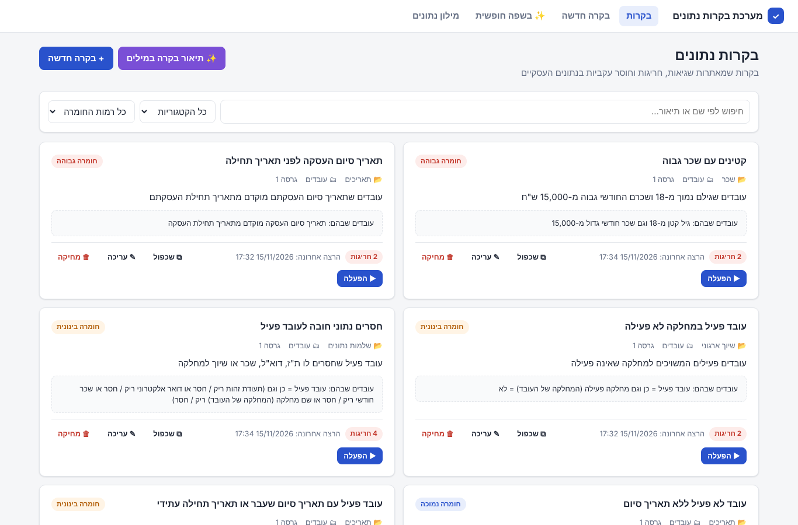
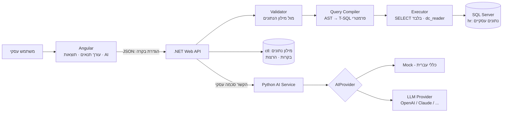

# מערכת בקרות נתונים דינאמית

מערכת Web גנרית להגדרה, הרצה וניתוח של בקרות איכות נתונים. היא מיועדת למשתמשים עסקיים שאינם מכירים SQL או את מבנה הטבלאות.

- **הגדרה ידנית:** המשתמש בוחר נתונים ובונה תנאים במונחים עסקיים ("עובד פעיל", "המחלקה של העובד"). המערכת מתרגמת אותם לשאילתת SQL מאובטחת ומחזירה את הרשומות החריגות, עם **הסבר לכל רשומה למה היא חריגה**.
- **שלב ב':** אפשר לתאר בקרה בשפה חופשית ("מצא עובדים פעילים שגילם נמוך מ-18 ומשכורתם גבוהה מ-15,000 ש"ח"). שכבת AI נפרדת מציעה הגדרה, והמשתמש מאשר אותה לפני השמירה וההרצה.

| טכנולוגיה | שימוש |
|---|---|
| **Angular 18** (Standalone, Signals) | ממשק משתמש בעברית ו-RTL |
| **.NET 8 Web API** | מנוע הבקרות: ולידציה, תרגום ל-SQL, הרצה, ניהול בקרות |
| **Python 3.12 / FastAPI** | שכבת ה-AI: Prompt, ספקי מודלים, Mock, הצעות יזומות |
| **SQL Server** | נתונים עסקיים, מילון נתונים עסקי, הגדרות בקרות והיסטוריית הרצות |



---

## ארכיטקטורה בקצרה



**העיקרון המרכזי:** בקרה נשמרת כ**עץ תנאים ב-JSON** במונחים עסקיים, ולא כ-SQL. אותו פורמט משמש את העורך הידני, את ה-AI, את מסד הנתונים ואת מנוע ההרצה. שמות הטבלאות והעמודות מגיעים **רק** ממילון הנתונים (`ctl.Entities / Fields / Relations`), ולכן כדי להוסיף טבלה, שדה או בקרה חדשים מוסיפים נתונים בלבד, בלי לשנות קוד.

פירוט מלא: [docs/ARCHITECTURE.md](docs/ARCHITECTURE.md)

---

## הרצה מהירה (Docker)

```bash
docker compose up --build
```

לאחר העלייה:

| שירות | כתובת |
|---|---|
| ממשק המשתמש | http://localhost:4200 |
| API + Swagger | http://localhost:5080/swagger |
| שירות AI (docs) | http://localhost:8000/docs |

סקריפטי ה-SQL רצים אוטומטית (שירות `db-init`) ומקימים את בסיס הנתונים, נתוני הדוגמה, מילון הנתונים, 13 בקרות לדוגמה ומשתמשי ההרשאות.

## הרצה ידנית (פיתוח)

**דרישות:** SQL Server 2019 ומעלה (או Express / LocalDB), sqlcmd, .NET 8 SDK, Node.js 20 ומעלה, Python 3.11 ומעלה.

### 1. בסיס נתונים
```powershell
cd database
./setup.ps1 -Server "localhost" -SaPassword "<sa password>"
```
או ב-SSMS: לפתוח את `database/00_run_all.sql`, להפעיל *Query → SQLCMD Mode*, להגדיר `:setvar AppPassword` ו-`:setvar ReaderPassword` ולהריץ.
הסקריפטים יוצרים את המשתמשים `dc_app` ו-`dc_reader` (ברירות המחדל לסיסמאות מופיעות ב-`appsettings.json`).

### 2. שירות ה-AI (Python)
```bash
cd ai-service
python -m venv .venv && .venv/Scripts/activate      # Linux/macOS: source .venv/bin/activate
pip install -r requirements-dev.txt
uvicorn app.main:app --port 8000
```

### 3. ה-API (.NET)
```bash
cd backend
dotnet run --project src/DataControls.Api            # http://localhost:5080/swagger
```
ה-connection strings נמצאים ב-`src/DataControls.Api/appsettings.json`.

### 4. צד הלקוח (Angular)
```bash
cd frontend
npm install
npm start                                            # http://localhost:4200 (proxy ל-API)
```

## בדיקות

```bash
cd backend && dotnet test          # 37 בדיקות: מתרגם SQL, הזרקות, ולידציה, תיאור בעברית, סיבות חריגה, חוזה AI
cd ai-service && pytest            # 26 בדיקות: פענוח עברית, הצעות יזומות, צנרת LLM עם Mock, API
cd frontend && npm run build       # קומפילציה במצב strict
```

---

## מבנה הפרויקט

```
database/          סקריפטי SQL: סכמה, נתוני דוגמה (תקינים ושגויים), מילון נתונים, בקרות, הרשאות
backend/
  src/DataControls.Domain          מודל ההגדרה (AST), מילון נתונים, קטלוג אופרטורים
  src/DataControls.Application     Use-cases, ולידציה, תיאור בעברית, סיבות חריגה, חוזה AI
  src/DataControls.Infrastructure  מתרגם T-SQL, הרצה מאובטחת, Repositories, לקוח AI
  src/DataControls.Api             Controllers, טיפול בשגיאות (ProblemDetails), Swagger
  tests/DataControls.Tests         xUnit
ai-service/
  app/contracts.py                 החוזה: הקשר סכמה, מבנה הגדרה, מבנה תשובת AI
  app/prompting.py                 בניית Prompt מתוך מבנה הנתונים
  app/providers/                   AIProvider · MockProvider · LLMProvider (+ Mock מוקלט)
  app/proactive.py                 הצעת בקרות יזומה (משימת רשות)
frontend/src/app/
  core/                            API, מאגר מילון נתונים (Signals), מודלים
  shared/                          טבלת תוצאות, תגיות, הודעות - רכיבים לשימוש חוזר
  features/                        רשימת בקרות · עורך · תוצאות · AI · מילון נתונים
docs/                              תיעוד
```

## תיעוד

| מסמך | תוכן |
|---|---|
| [ARCHITECTURE.md](docs/ARCHITECTURE.md) | ארכיטקטורה, זרימות, אבטחה, ביצועים, הרחבה |
| [CONTROL_DEFINITION.md](docs/CONTROL_DEFINITION.md) | פורמט הגדרת בקרה (JSON) ואיך הוא מתורגם ל-SQL |
| [EXAMPLES.md](docs/EXAMPLES.md) | בקרות לדוגמה, תוצאות צפויות ודוגמאות בשפה חופשית |
| [AI_LAYER.md](docs/AI_LAYER.md) | שלב ב': תשתית ה-AI, החוזה, ה-Mock והחלפת מודל |
| [ASSUMPTIONS_AND_LIMITATIONS.md](docs/ASSUMPTIONS_AND_LIMITATIONS.md) | הנחות עבודה, מגבלות, הרחבות אפשריות |
| [AI_TOOLS_USED.md](docs/AI_TOOLS_USED.md) | כלי ה-AI ששימשו בפיתוח ולמה |
