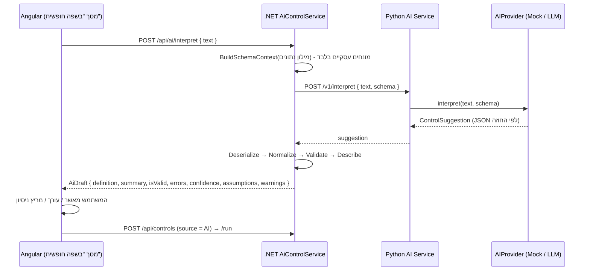
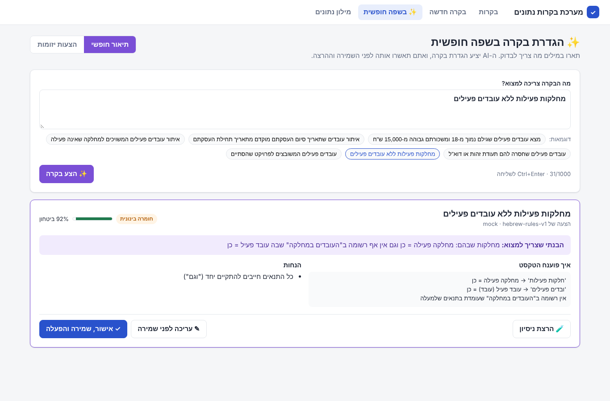
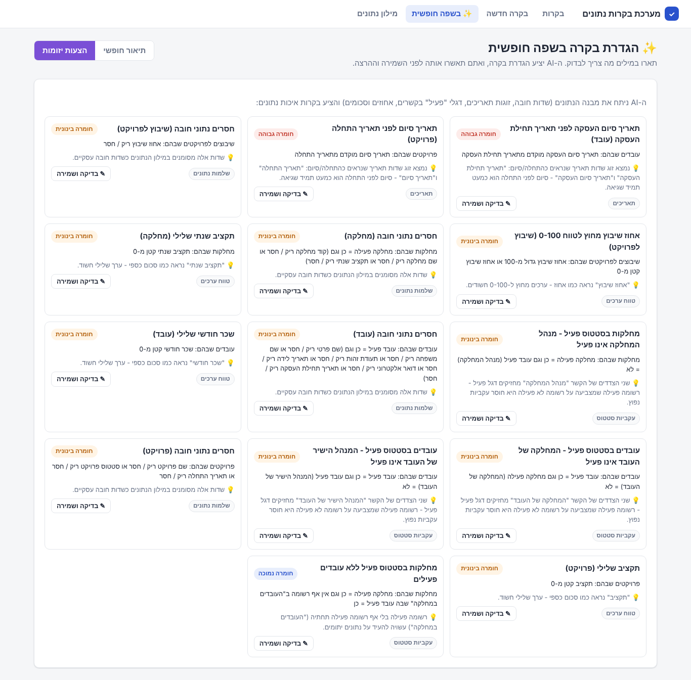

# שלב ב' - תשתית להגדרת בקרות בשפה חופשית

## מטרה ועקרונות
המשתמש מתאר בקרה במילים, ה-AI מציע הגדרה, והמשתמש **מאשר** לפני שמירה והרצה.

1. **ה-AI לא מייצר SQL.** הוא מחזיר את אותו פורמט JSON שהעורך הידני מייצר, ולכן אותו מנוע (ולידציה ← תרגום ← הרצה) מטפל בשניהם.
2. **תשובת AI היא קלט לא מהימן.** היא עוברת פענוח לפי חוזה (Pydantic ב-Python, ומבנה מוקלד ב-.NET) וּולידציה מלאה מול מילון הנתונים. שדה "מומצא" נדחה.
3. **הפרדה מלאה.** שירות Python נפרד מאחורי `IAiControlAssistant`. החלפת מודל לא נוגעת בלוגיקת הבקרות.
4. **Human in the loop.** התוצאה היא תמיד טיוטה, עם תיאור בעברית, רמת ביטחון, הנחות ואזהרות. אפשר לבצע הרצת ניסיון, לערוך בעורך הרגיל או לשמור.

## זרימה



## 1. המידע שמועבר למודל (`SchemaContext`)
נבנה אוטומטית ממילון הנתונים (`AiControlService.BuildSchemaContext`), ונחשף ב-`GET /api/ai/schema-context`:
- ישויות: מפתח, שם, שם ברבים, תיאור ומילים נרדפות.
- שדות: מפתח, שם, תיאור, סוג, חובה עסקית, ערכים מותרים ומילים נרדפות.
- קשרים: מפתח, שם, ישות יעד ו-Cardinality.
- קטלוג האופרטורים וסוגי הערכים.

**לא נשלחים** שמות טבלאות, שמות עמודות או נתונים עצמם. זו אבטחה ופרטיות, וגם שומר על המודל בשפה העסקית. דוגמה מלאה: `ai-service/fixtures/schema-context.json`.

## 2. מבנה התשובה המצופה (`ControlSuggestion`)
מוגדר ב-`ai-service/app/contracts.py` ונחשף כ-JSON Schema ב-`GET /v1/response-schema`:

```json
{
  "name": "עובדים פעילים קטינים עם שכר גבוה",
  "description": "...",
  "category": "שכר",
  "severity": "high",
  "definition": { "rootEntity": "employee", "filter": { "type": "group", "logic": "and", "children": [ ... ] } },
  "confidence": 0.93,
  "explanation": "'גילם נמוך מ-18' → גיל < 18 ...",
  "assumptions": ["השכר הוא שכר חודשי ברוטו"],
  "warnings": [],
  "unmatchedTerms": []
}
```
אם הבקשה לא ניתנת למיפוי: `definition = null`, ההסבר מופיע ב-`warnings` והמונחים שלא זוהו ב-`unmatchedTerms`. כך המודל אינו "ממציא".

## 3. ה-Prompt (`app/prompting.py`)
- **System:** תפקיד וחוקים: רק מפתחות מהסכמה, לעולם לא SQL, `filter` הוא תנאי החריגה, ושפת התשובה.
- **מבנה הנתונים:** טקסט קומפקטי שנגזר מה-SchemaContext.
- **JSON Schema של התשובה + דוגמה (few-shot).**
- **לולאת תיקון:** אם התשובה לא עוברת פענוח או שמכילה שדה שלא קיים, נשלחת למודל הודעת המשך עם רשימת הבעיות. ראו `build_repair_prompt`.

אפשר לצפות ב-Prompt המלא בלי מודל: `POST /v1/prompt-preview`.

## 4. ספקים (Providers)

```
AIProvider (ABC)
 ├── MockProvider        מפענח עברית מבוסס-כללים (ברירת מחדל)
 └── LLMProvider         צנרת משותפת לכל מודל שפה: Prompt → טקסט → JSON → ולידציה → תיקון
        └── LLMClient    (Protocol) complete(system, messages) -> str
              ├── RecordedLLMClient   Mock: תשובות "מוקלטות" מ-fixtures/llm_recordings.json
              └── NotConfiguredClient מקום לספק אמיתי (openai / anthropic / azure)
```
הבחירה נעשית ב-`app/factory.py` לפי משתני סביבה:

| משתנה | ערכים |
|---|---|
| `AI_PROVIDER` | `mock` (ברירת מחדל) / `llm` |
| `LLM_CLIENT` | `recorded` / `openai` / `anthropic` / ... |

### הדגמת Mock - שתי רמות
1. **`MockProvider`:** מדמה מודל "חכם". אוצר המילים נלקח **מה-SchemaContext** (שמות ומילים נרדפות), ולא מהקוד. הוא תומך באותיות שימוש וסיומות, השוואות, מספרים ותאריכים, "היום", השוואה לשדה אחר, ערכים מרשימה סגורה, שלילה, "או", וקשרים (נתיב / קיים / לא קיים). בדיקה מוכיחה שהוספת שדה "בונוס" למילון מספיקה כדי שהמפענח יזהה "מענק".
2. **`LLMProvider` + `RecordedLLMClient`:** מדגים את צנרת ה-LLM האמיתית. התשובה מגיעה כטקסט גולמי (כולל ```json ...```), מפוענחת ומאומתת. כשה"מודל" מחזיר שדה שלא קיים (`bonus`), נשלחת אוטומטית בקשת תיקון. נבדק ב-`tests/test_llm_provider.py`.

### חיבור מודל אמיתי בעתיד
```python
class AnthropicClient:            # או OpenAI / Azure / מודל מקומי
    model = "claude-..."
    def complete(self, system, messages) -> str:
        return sdk.messages.create(model=self.model, system=system, messages=messages, ...).content[0].text
```
רושמים אותו ב-`factory.py` ומגדירים `AI_PROVIDER=llm LLM_CLIENT=anthropic`. **אין שינוי ב-.NET, ב-Angular או במנוע הבקרות.**

## 5. תרגום התשובה להגדרת בקרה (.NET)
`AiControlService.ToDraft`:
1. `DefinitionSerializer.Deserialize`: אותו ממיר JSON של השמירה. סוג צומת לא מוכר נדחה.
2. `DefinitionNormalizer`: משלים מזהי צמתים.
3. `ControlDefinitionValidator`: אותה ולידציה כמו בקלט ידני.
4. `DefinitionDescriber`: משפט בעברית לאישור המשתמש.

תשובה לא תקינה **אינה נזרקת**. היא מוצגת למשתמש עם השגיאות, והוא יכול לנסח מחדש או לעבור להגדרה ידנית.

**בדיקת חוזה מקצה לקצה:** 25 תשובות של שירות ה-Python (11 תיאורים חופשיים ו-14 הצעות יזומות) הועברו דרך ה-Validator וה-Compiler של .NET. כולן התקבלו ותורגמו ל-SQL.

## 6. משימת רשות - הצעת בקרות יזומה
`GET /api/ai/suggestions` ← `POST /v1/suggest-controls`. מוצג בלשונית **"הצעות יזומות"**.

ב-Mock (`app/proactive.py`) הכללים גנריים ומבוססים על *מאפייני* המילון, ולא על שמות:

| כלל | זיהוי | בקרה מוצעת |
|---|---|---|
| זוג תאריכים | שדות תאריך עם רמזי התחלה/סיום (`start/end`, "תחילת/סיום") | סיום מוקדם מהתחלה |
| שדות חובה | `isBusinessRequired` | אחד משדות החובה ריק (ברשומה פעילה, אם יש דגל "פעיל") |
| עקביות סטטוס (ManyToOne) | דגל "פעיל" בשני צדי הקשר | רשומה פעילה המקושרת לרשומה לא פעילה |
| עקביות סטטוס (OneToMany) | דגל "פעיל" בשני צדי הקשר | רשומה פעילה ללא אף רשומה פעילה תחתיה |
| אחוזים | שדה מספרי עם רמז "אחוז" | מחוץ ל-0–100 |
| סכומים | שדה מספרי עם רמז שכר/תקציב/סכום | ערך שלילי |

עם מודל אמיתי, `build_suggest_prompt` שולח את אותו SchemaContext ומבקש הצעות באותו חוזה. ההצעות עוברות `find_problems` ב-Python ואז ולידציה ב-.NET. בעתיד אפשר להעשיר את ההקשר בסטטיסטיקות פרופיל (אחוז NULL, טווחי ערכים) לבקרות מדויקות יותר.



