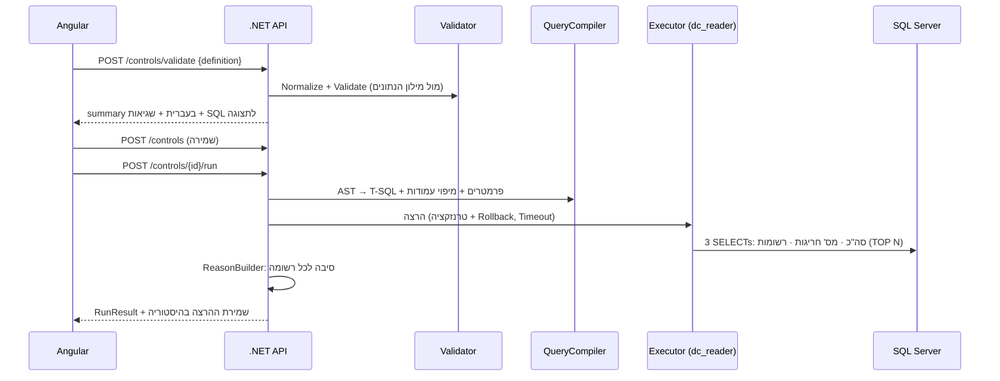

# ארכיטקטורה ומנגנון הבקרות

## 1. עקרונות התכנון

| עיקרון | איך הוא מומש |
|---|---|
| **גנריות** | אין בקוד אף שם של טבלה או עמודה עסקית. המנוע לומד את המבנה ממילון נתונים שמור ב-DB. בקרה חדשה היא שורת נתונים, וטבלה חדשה היא שורות במילון. |
| **הפרדה בין הגדרה למימוש** | בקרה נשמרת כעץ תנאים (AST) עסקי. התרגום ל-SQL הוא מימוש מוחלף (`IQueryCompiler`) ב-Infrastructure. |
| **אבטחה בשכבות** | אין קבלת SQL מהלקוח, יש Whitelist של מזהים, כל הערכים עוברים כפרמטרים, נוצר `SELECT` בלבד, ההרצה נעשית עם משתמש DB לקריאה בלבד, ויש טרנזקציה שמבוטלת תמיד ו-Timeout. |
| **ידידותיות עסקית** | שמות בעברית, מילים נרדפות, תיאור הבקרה כמשפט, והסבר לכל רשומה חריגה. |
| **AI כשכבה נפרדת** | ה-AI מחזיר את **אותו** פורמט הגדרה, והתשובה מאומתת כמו קלט משתמש. החלפת מודל לא נוגעת בלוגיקת הבקרות. |

## 2. רכיבים

```
┌────────────────────────── Angular ──────────────────────────┐
│ ControlsList · ControlEditor(ConditionGroup ↻ ConditionRow) │
│ ControlRun(ResultsTable) · AiAssistant · DataDictionary      │
│ MetadataStore (Signals) ← כל הממשק נגזר ממילון הנתונים       │
└───────────────┬──────────────────────────────────────────────┘
                │ REST / JSON
┌───────────────▼────────────── .NET 8 ───────────────────────┐
│ Api            Controllers · GlobalExceptionHandler          │
│ Application    ControlService · ControlRunner · AiControlSvc │
│                Validator · Normalizer · Describer · Reasons  │
│ Domain         ControlDefinition(AST) · DataModel · Operators│
│ Infrastructure SqlServerQueryCompiler · SqlQueryExecutor     │
│                SqlMetadataProvider(cache) · Repositories     │
│                PythonAiControlAssistant (HTTP)               │
└───────┬───────────────────────────────┬──────────────────────┘
        │ dc_app (ctl)  dc_reader (hr)  │ HTTP
┌───────▼─────── SQL Server ──────┐ ┌───▼──── Python / FastAPI ───┐
│ hr  : נתונים עסקיים + Views    │ │ AIProvider ← factory (env)   │
│ ctl : Entities/Fields/Relations │ │  ├ MockProvider (כללי עברית) │
│       Controls/ControlRuns      │ │  └ LLMProvider + LLMClient   │
└─────────────────────────────────┘ │ PromptBuilder · Proactive    │
                                    └──────────────────────────────┘
```

### שכבות ב-.NET (Clean Architecture)
- **Domain:** מודלים טהורים ללא תלויות. `ControlDefinition` (עץ: Group / Condition / Related), `DataModel` (מילון נתונים), `OperatorCatalog` (מקור אמת יחיד לאופרטורים ולתוויות בעברית), `FieldPathResolver` (פענוח נתיב כמו `department.manager.isActive`).
- **Application:** Use-cases שאינם מכירים SQL. הם עובדים מול ממשקים (`IQueryCompiler`, `IQueryExecutor`, `IControlRepository`, `IMetadataProvider`, `IAiControlAssistant`).
- **Infrastructure:** המימושים הספציפיים ל-SQL Server ול-HTTP.
- **Api:** שכבה דקה: ניתוב, JSON, ProblemDetails ו-Swagger.

## 3. מילון הנתונים (השכבה הסמנטית)

| טבלה | תפקיד | דוגמה |
|---|---|---|
| `ctl.Entities` | ישות עסקית ← טבלה/View | `employee` ← `hr.vw_EmployeesEnriched` ("עובד" / "עובדים") |
| `ctl.Fields` | שדה עסקי ← עמודה, סוג, חובה עסקית, ערכים סגורים, מילים נרדפות | `monthlySalary` ← `MonthlySalary` ("שכר חודשי", number) |
| `ctl.Relations` | קשר עסקי + Cardinality | `employee.department` (ManyToOne) "המחלקה של העובד" |

- **שדות מחושבים** (גיל, ותק) מוגדרים ב-View, כך שהם מוגדרים פעם אחת ב-DB ולא בקוד.
- **גילוי סכמה:** `GET /api/metadata/discover` משווה את קטלוג ה-DB למילון ומציג טבלאות, עמודות ומפתחות זרים שעדיין לא ממופים. כך קל להרחיב את המילון.
- המילון נשמר במטמון (IMemoryCache, 5 דקות). `POST /api/metadata/refresh` מרענן אותו.

## 4. מחזור החיים של בקרה



## 5. התרגום ל-SQL (`SqlServerQueryCompiler`)

| מבנה בהגדרה | SQL שנוצר |
|---|---|
| קבוצה `and` / `or` / `negate` | `( a AND b )`, `( a OR b )`, `(NOT (...))` |
| שדה של הישות | `t0.[Age] < @p0` |
| נתיב דרך קשר ManyToOne (`department.isActive`) | `LEFT JOIN [hr].[Departments] AS t1 ON t1.[DepartmentId] = t0.[DepartmentId]`, **פעם אחת לכל נתיב** |
| תנאי על קשר OneToMany (`related`) | `EXISTS (SELECT 1 FROM ... WHERE <קורלציה> AND <תנאים פנימיים>)` / `NOT EXISTS` |
| השוואה לשדה אחר | `t0.[EndDate] < t0.[StartDate]` |
| "היום" | `DATEADD(DAY, n, CAST(GETDATE() AS DATE))` (מחושב בשרת בזמן ריצה) |
| `isEmpty` לטקסט | `(col IS NULL OR LTRIM(RTRIM(col)) = N'')` |
| `neq` / `notIn` | כוללים `OR col IS NULL`, כי "שונה מ" כולל גם ערך חסר |
| `contains` | `LIKE @p ESCAPE '\'` (תווי `%`, `_`, `[` בערך מוברחים) |

**סיבת החריגה:** לכל צומת ברמת הישות הראשית נוספת עמודת דגל `CASE WHEN <תנאי> THEN 1 ELSE 0 END`. בנוסף נבחרים הערכים בפועל של כל שדה שמשתתף בתנאי. `ReasonBuilder` עובר על העץ, מוצא אילו תנאים התקיימו בכל רשומה, ומנסח, למשל: `גיל: 16 (קטן מ-18)` או `תאריך סיום העסקה: 31/12/2020 (מוקדם מתאריך תחילת העסקה (01/03/2021))`. ב"או" מוצגים רק התנאים שהתקיימו בפועל.

**למה LEFT JOIN ל-ManyToOne ו-EXISTS ל-OneToMany?** JOIN לטבלת "רבים" משכפל רשומות ומעוות את ספירת החריגות. EXISTS שומר על רשומה אחת לכל ישות ומאפשר ל-SQL Server לעצור בהתאמה הראשונה (Semi-Join).

## 6. אבטחה

1. **אין SQL מהלקוח.** ה-API מקבל עץ JSON מוקלד בלבד. סוג צומת לא מוכר נדחה כבר בשלב ה-Deserialization.
2. **Whitelist של מזהים.** טבלאות ועמודות נלקחות רק ממילון הנתונים, ושם רק מזהים שעוברים `^[A-Za-z_][A-Za-z0-9_]*$` נטענים ומצוטטים ב-`[...]`. שדה שהמשתמש או ה-AI "המציאו" נדחה בוולידציה.
3. **פרמטרים מוקלדים.** כל ערך עובר כ-`SqlParameter` עם `SqlDbType` מתאים, ולעולם לא בשרשור.
4. **SELECT בלבד.** המתרגם לא מכיל אף נתיב קוד שמייצר DML. בנוסף, `EnsureReadOnly` בודק את הטקסט לפני ההרצה.
5. **Least Privilege ב-DB.** להרצת בקרות משמש `dc_reader`, עם `SELECT` על `hr` בלבד ו-`DENY` על כל השאר. ניהול ההגדרות משתמש ב-`dc_app`, שאין לו גישה לנתונים העסקיים.
6. **טרנזקציה שמבוטלת תמיד, Timeout, ו-TOP N** להגנה על ה-DB.
7. **הגבלות מורכבות:** עד 60 צמתים, 6 רמות קינון, 3 קשרים בנתיב ו-200 ערכים ברשימה.
8. **שגיאות:** ProblemDetails עם הודעה בעברית. פרטים טכניים נרשמים בלוג בלבד ומקושרים ב-`traceId`.

## 7. ביצועים
- שאילתה אחת עם 3 Result Sets: סה"כ, חריגות ורשומות (round-trip אחד).
- אינדקסים על כל המפתחות הזרים, שבהם משתמשים ה-JOIN וה-EXISTS.
- `TOP (MaxResultRows)` מחזיר עד 5,000 רשומות למסך. הספירה הכוללת מדויקת תמיד.
- מילון הנתונים נשמר במטמון.
- **בהמשך:** הרצה מתוזמנת ברקע עם שמירת תוצאות, דפדוף בצד השרת, ו-Read Replica (`ApplicationIntent=ReadOnly` כבר מוגדר).

## 8. צד הלקוח
- **Standalone Components + Signals.** `MetadataStore` מחזיק את מילון הנתונים, וכל הממשק נגזר ממנו: רשימת הישויות, השדות (כולל שדות דרך קשרים), האופרטורים המותרים לפי סוג ושדה הקלט המתאים.
- **עורך רקורסיבי:** `ConditionGroupComponent` מציג את עצמו לקבוצות מקוננות ולתנאי "קיים / לא קיים". `ConditionRow`, `FieldPicker` ו-`ValueInput` הם רכיבים לשימוש חוזר.
- **משוב חי:** בכל שינוי (עם debounce) ההגדרה נבדקת בשרת. מוצגים משפט בעברית שמתאר מה הבקרה תאתר, שגיאות שמסומנות על השורה הרלוונטית, וה-SQL שייווצר (לשקיפות).
- **`ResultsTable` לשימוש חוזר:** חיפוש, סינון לפי סיבת חריגה, מיון, דפדוף וייצוא ל-CSV (עם BOM ל-Excel).
- Lazy loading לכל מסך, RTL מלא ופריסה רספונסיבית.

## 9. הרחבה

| צורך | מה עושים |
|---|---|
| טבלה עסקית חדשה | שורות ב-`ctl.Entities/Fields/Relations` (או דרך `discover`). אין שינוי קוד. |
| שדה מחושב | עמודה ב-View + שורה ב-`ctl.Fields` |
| בקרה חדשה | דרך הממשק, דרך ה-AI, או `INSERT` ל-`ctl.Controls` |
| אופרטור חדש | `OperatorCatalog` + case אחד במתרגם. הממשק מתעדכן אוטומטית. |
| DB אחר (Postgres וכו') | מימוש נוסף ל-`IQueryCompiler` / `IQueryExecutor` |
| מודל AI אחר | מימוש `LLMClient` ב-Python + משתנה סביבה. .NET לא משתנה. |
