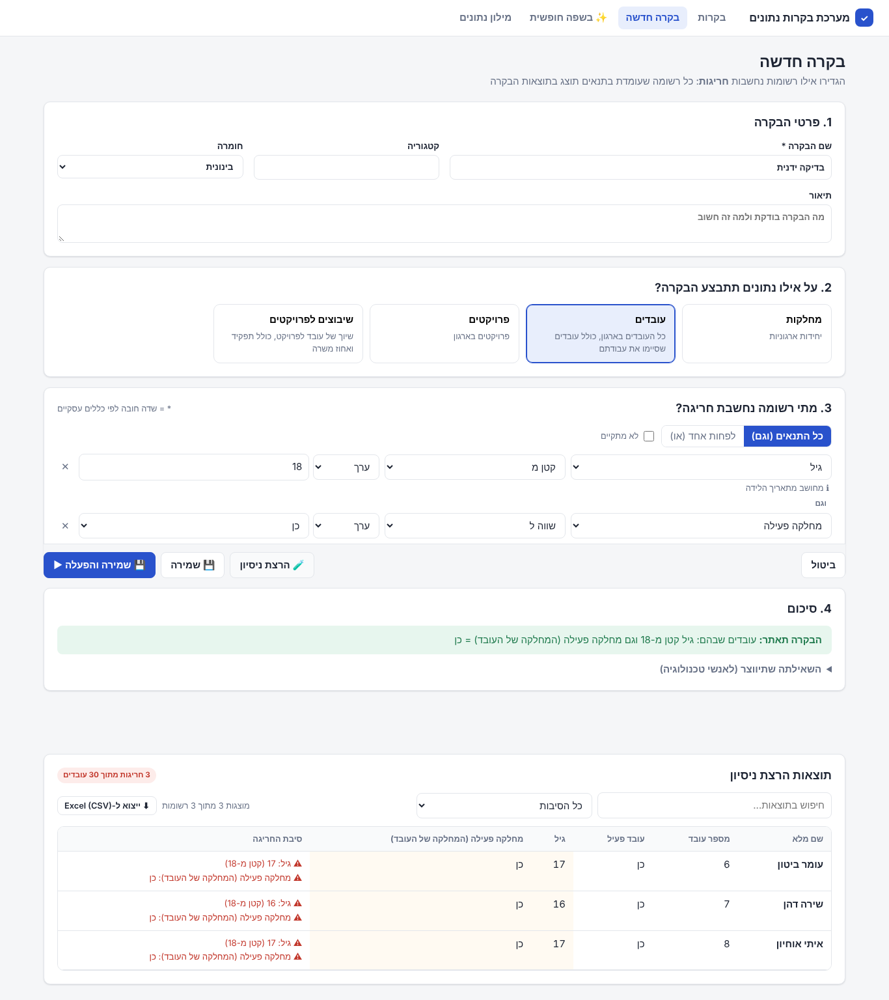
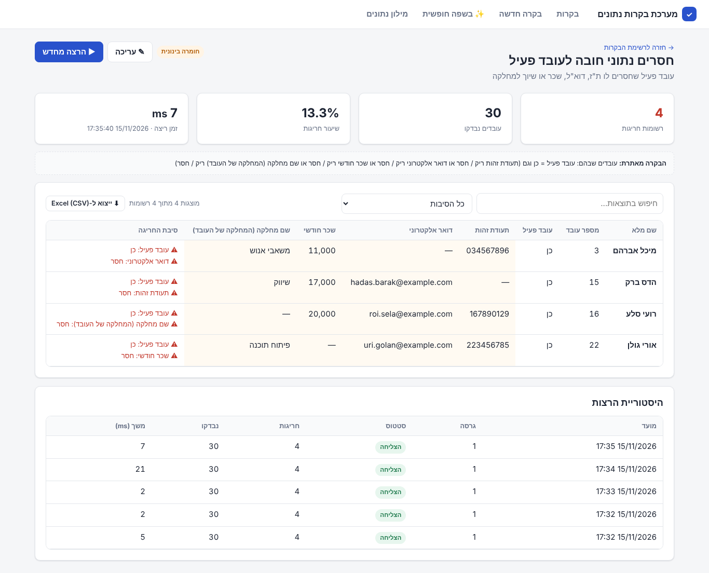

# דוגמאות לבקרות

## נתוני הדוגמה
`database/03_business_seed.sql` מכיל 7 מחלקות, 30 עובדים, 6 פרויקטים ו-14 שיבוצים. כל רשומה שגויה מסומנת בהערה `[שגוי: ...]`.

## 13 הבקרות המוגדרות מראש (`06_sample_controls.sql`)

התוצאות למטה התקבלו בהרצה מקצה לקצה של המנוע על נתוני הדוגמה. **כל בקרה תופסת בדיוק את הרשומות השגויות שתוכננו.**

| # | בקרה | תיאור שנוצר אוטומטית | חריגות | רשומות שנמצאו |
|---|---|---|---|---|
| 1 | קטינים עם שכר גבוה | עובדים שבהם: גיל קטן מ-18 וגם שכר חודשי גדול מ-15,000 | 2/30 | עומר ביטון, שירה דהן |
| 2 | תאריך סיום לפני תאריך תחילה | תאריך סיום העסקה מוקדם מתאריך תחילת העסקה | 2/30 | גל חדד, תמר גבאי |
| 3 | עובד פעיל במחלקה לא פעילה | עובד פעיל = כן וגם מחלקה פעילה (המחלקה של העובד) = לא | 2/30 | אלון רוזן, ליאת קליין |
| 4 | חסרים נתוני חובה לעובד פעיל | עובד פעיל = כן וגם (ת"ז ריק או דוא"ל ריק או שכר ריק או שם מחלקה ריק) | 4/30 | מיכל אברהם, הדס ברק, רועי סלע, אורי גולן |
| 5 | עובד לא פעיל ללא תאריך סיום | עובד פעיל = לא וגם תאריך סיום העסקה ריק | 2/30 | ניר אלמוג, יעל שטרן |
| 6 | פעיל עם סיום שעבר / תחילה עתידית | עובד פעיל = כן וגם (תאריך סיום מוקדם מהיום או תאריך תחילה מאוחר מהיום) | 2/30 | עידן נחום, שני אדלר |
| 7 | שכר לא תקין | עובד פעיל = כן וגם שכר חודשי קטן או שווה ל-0 | 1/30 | מאיה פרידמן |
| 8 | כתובת דוא"ל לא תקינה | דוא"ל מלא וגם דוא"ל אינו מכיל "@" | 1/30 | תום רביבו |
| 9 | מחלקה פעילה ללא עובדים פעילים | מחלקה פעילה = כן וגם אין אף רשומה ב"העובדים במחלקה" שבה עובד פעיל = כן | 2/7 | לוגיסטיקה, מוקד שירות |
| 10 | מחלקה פעילה ללא מנהל פעיל | מחלקה פעילה = כן וגם (שם מלא (מנהל המחלקה) ריק או עובד פעיל (מנהל המחלקה) = לא) | 3/7 | שיווק, לוגיסטיקה, מוקד שירות |
| 11 | עובד פעיל משובץ לפרויקט שהסתיים | ... קיימת רשומה ב"השיבוצים של העובד" שבה סטטוס פרויקט (הפרויקט) = "הסתיים" | 4/30 | נועה פרץ, קרן וקנין, בן טל, דוד מלכה |
| 12 | שיבוץ לא תקין | אחוז שיבוץ גדול מ-100 או אחוז שיבוץ ריק | 2/14 | (מתמחה 120%), (מגייסת - חסר) |
| 13 | פרויקט עם סיום לפני התחלה | תאריך סיום מוקדם מתאריך התחלה | 1/6 | ניסוי AI |

הבקרות מכסות את כל סוגי היכולות: AND/OR מקוננים, השוואה לשדה אחר, קשר ManyToOne בנתיב (כולל שתי קפיצות: `manager.isActive`), קשר OneToMany עם `none` ועם `any` (כולל נתיב בתוך הקשר: `project.status`), "היום", חוסר ערך וטקסט.

## דוגמאות להגדרה בשפה חופשית (שלב ב')

כל הדוגמאות האלו מפוענחות נכון על ידי ה-Mock, ומכוסות בבדיקות (`ai-service/tests/test_mock_provider.py`):

| טקסט | הגדרה שנוצרת |
|---|---|
| מצא עובדים פעילים שגילם נמוך מ־18 ומשכורתם גבוהה מ־15,000 ש"ח | עובד פעיל = כן וגם גיל < 18 וגם שכר > 15,000 |
| איתור עובדים שתאריך סיום העסקתם מוקדם מתאריך תחילת העסקתם | תאריך סיום < תאריך תחילה (השוואה בין שדות) |
| איתור עובדים פעילים המשויכים למחלקה שאינה פעילה | פעיל = כן וגם `department.isActive` = לא |
| עובדים פעילים שחסרה להם תעודת זהות או דוא"ל | פעיל = כן וגם (ת"ז ריק **או** דוא"ל ריק) |
| מחלקות פעילות ללא עובדים פעילים | פעילה = כן וגם `related employees none (isActive = כן)` |
| עובדים פעילים המשובצים לפרויקט שהסתיים | `related assignments any (project.status = "הסתיים")` |
| עובדים במשרה חלקית ששכרם מעל 20000 | סוג העסקה = "משרה חלקית" וגם שכר > 20,000 |
| עובדים שהתחילו לעבוד אחרי 01/01/2025 | תאריך תחילה > 2025-01-01 |
| עובדים פעילים שתאריך הסיום שלהם לפני היום | פעיל = כן וגם תאריך סיום < היום |
| שיבוצים שאחוז השיבוץ בהם גבוה מ-100 | אחוז שיבוץ > 100 |
| מצא את כל הלקוחות עם חוב | ⚠ אין הגדרה: "לא זוהתה ישות עסקית" (לא ממציא) |

## יצירת בקרה ידנית - תרחיש לדוגמה
1. **בקרה חדשה** ← בוחרים **עובדים**.
2. תנאי 1: **גיל** · **קטן מ** · `18`.
3. **+ תנאי** ← **מחלקה פעילה** (מקבוצת "המחלקה של העובד") · **שווה ל** · **לא**.
4. בסיכום מופיע: *"עובדים שבהם: גיל קטן מ-18 וגם מחלקה פעילה (המחלקה של העובד) = לא"*.
5. **🧪 הרצת ניסיון** מציגה את התוצאות בלי לשמור. **שמירה והפעלה** שומרת ועוברת למסך התוצאות.

